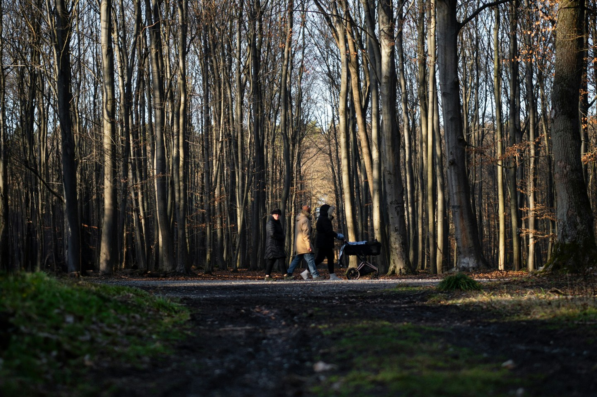
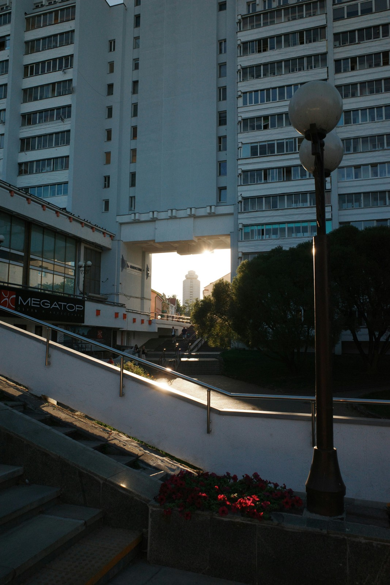
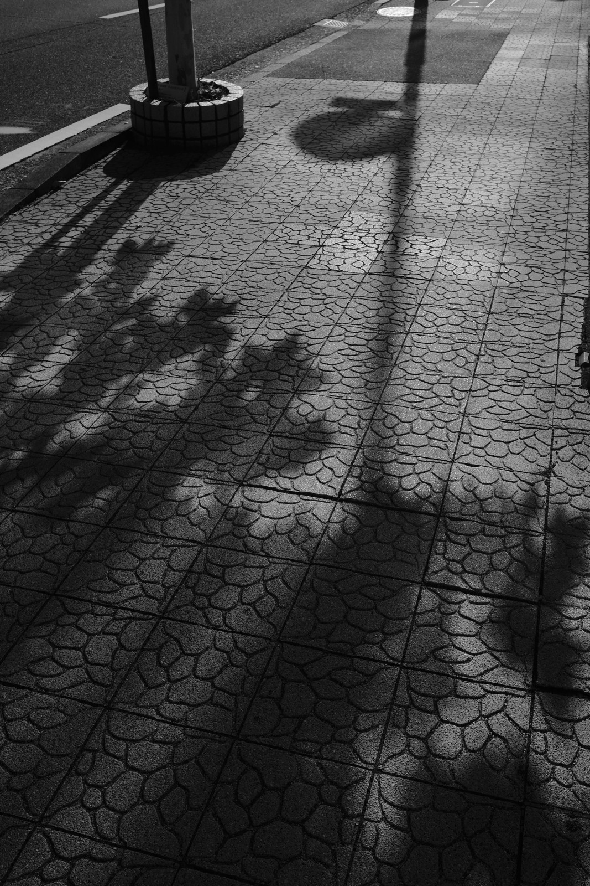
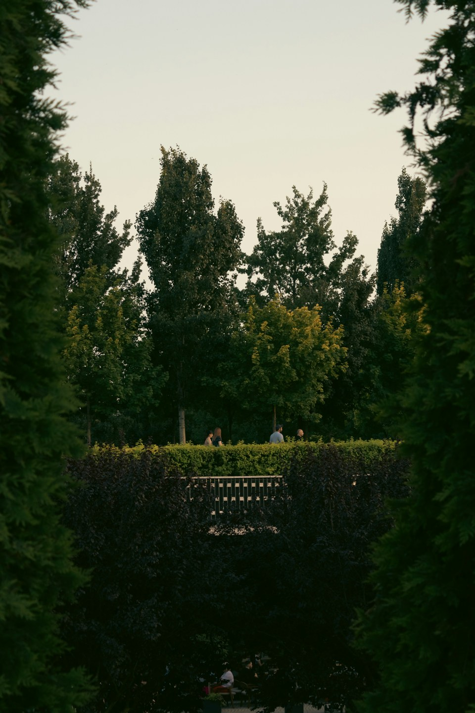
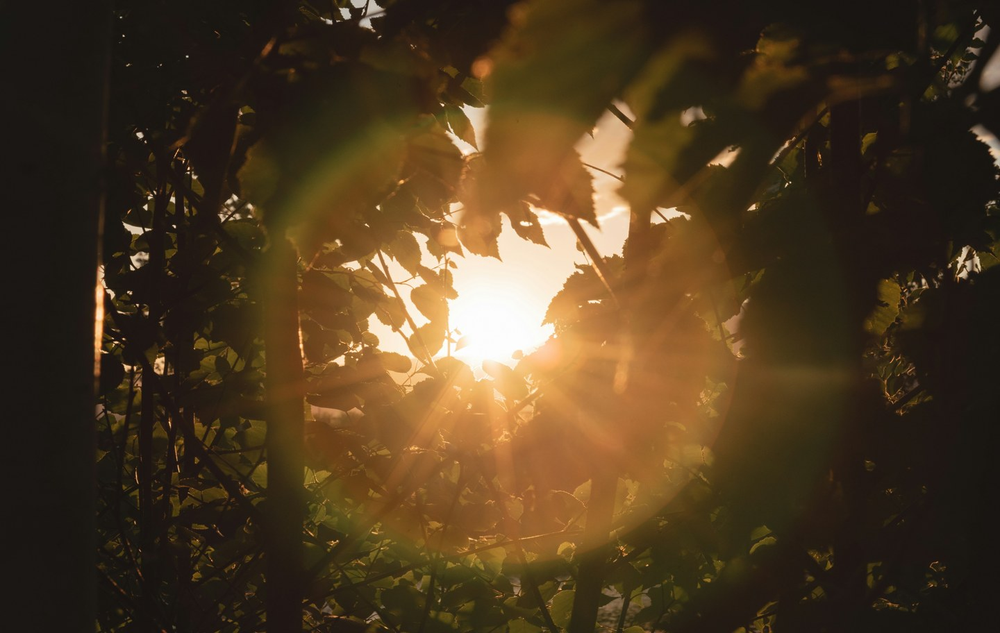

# 给周末留一段慢走的时间

周末出门，有时比上班还忙。先选一家店，再查一条路线，走到哪里都惦记着下一站。到了晚上，手机里添了不少照片，人却没有多少闲下来的感觉。

不妨给自己留一段没有打卡清单的路。远近都可以，走到哪儿算哪儿。路边有树，就看看树；遇到长椅，也可以坐一会儿。

## 从熟悉的地方出发

不用专门找一处风景。家门口的小路、学校外的一条街，或者常常匆匆经过的公园，都可以成为起点。

平时赶路，目光容易只落在前方。慢下来后，可以看看路两旁：哪家店换了招牌，树叶是什么颜色，阳光照到台阶上的时候，影子往哪边落。

这些细节不需要整理成什么收获。看见了就好，忘了也没有关系。

## 给中途停下来留个位置

路线不必排满。看见一张合适的长椅，就坐一会儿。带一瓶水，翻几页书，或者什么也不做。

> 散步可以没有一个值得汇报的结果。

如果和朋友同行，不必一直找话题。聊到哪里算哪里，安静地走一段也很好。一个人出门，也不用急着把每个片刻拍下来。

## 拍照前，先多看一会儿

看到好看的光，先别急着拿手机。看看它落在哪片叶子上，再往旁边挪一步，画面也许就变了。

想拍照当然可以。拍完以后把手机放回口袋，继续往前走。留下来的照片，够自己日后想起这一小段时间就行。

不拍也可以。有些风景只在经过的时候看一眼，并不影响它曾经让人停下脚步。

## 走到想回家的时候

出门前可以给自己一个很小的安排：找一条容易返回的路，穿双舒服的鞋，留一点不用赶时间的余地。

走累了就回去，遇到天气变化也可以提前结束。不必为了完成某个步数，把原本轻松的散步又变成一项任务。

下一个空闲的周末，试着从熟悉的路口出发。手机可以带着，清单就先放在家里。
